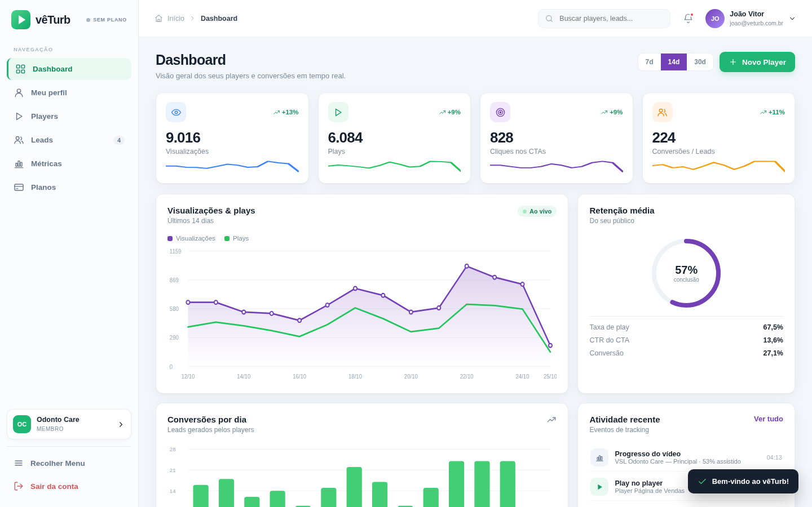
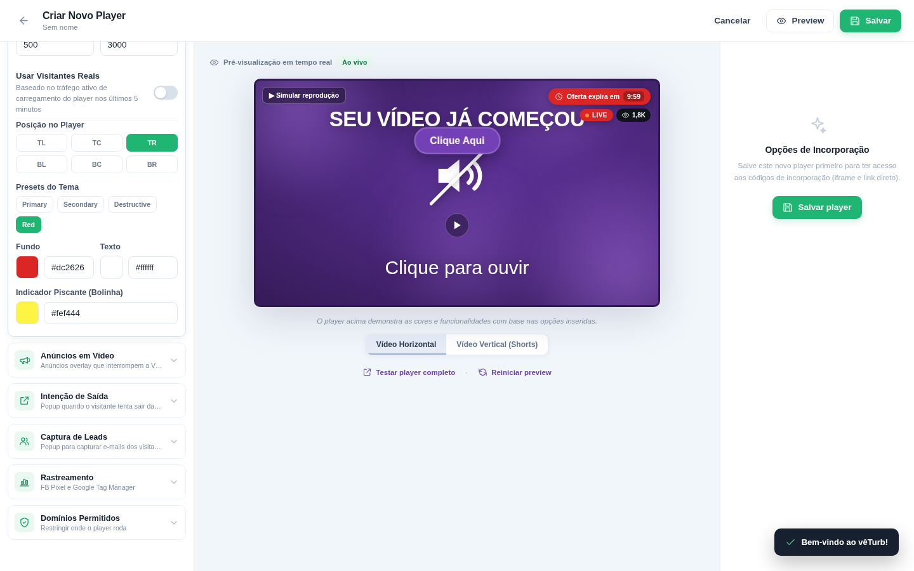
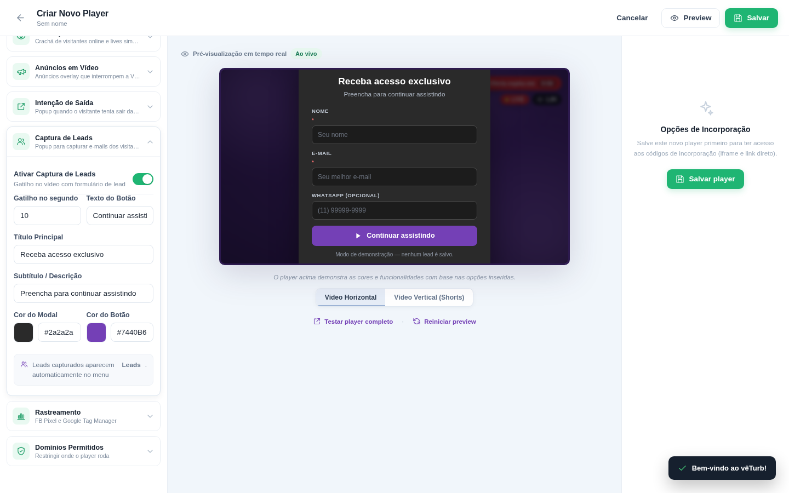
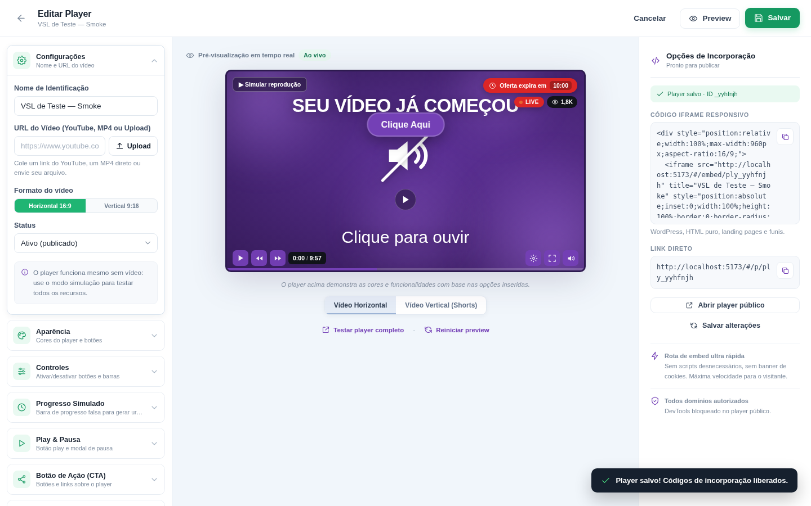
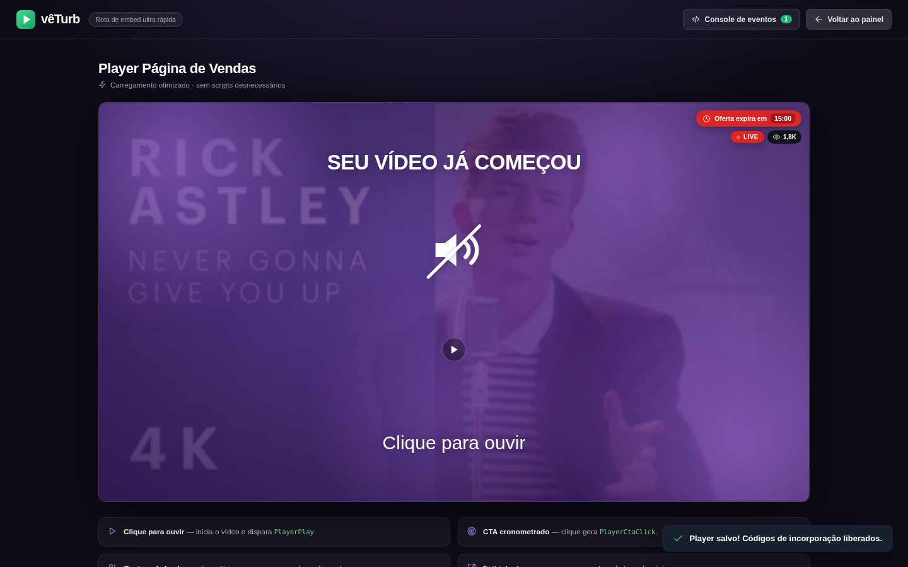
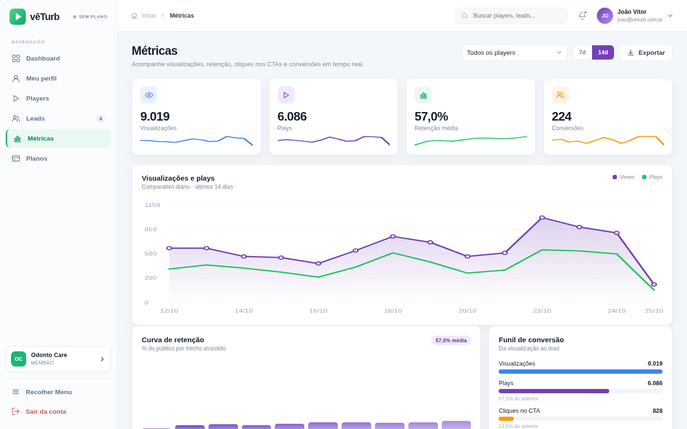
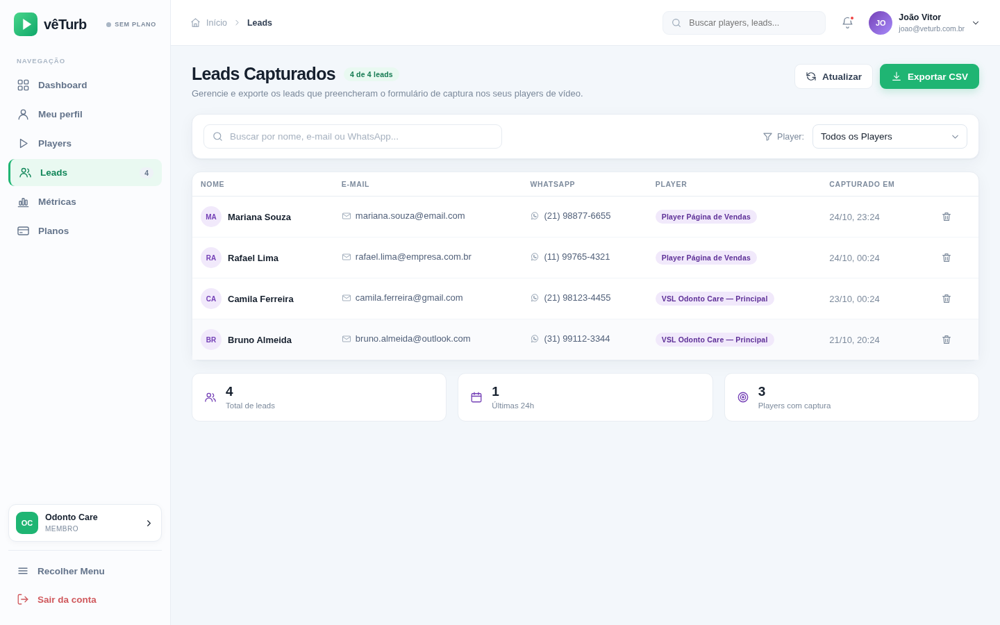
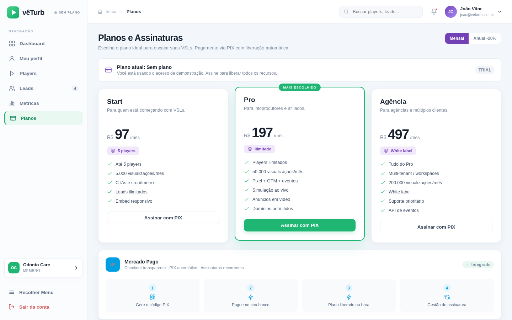
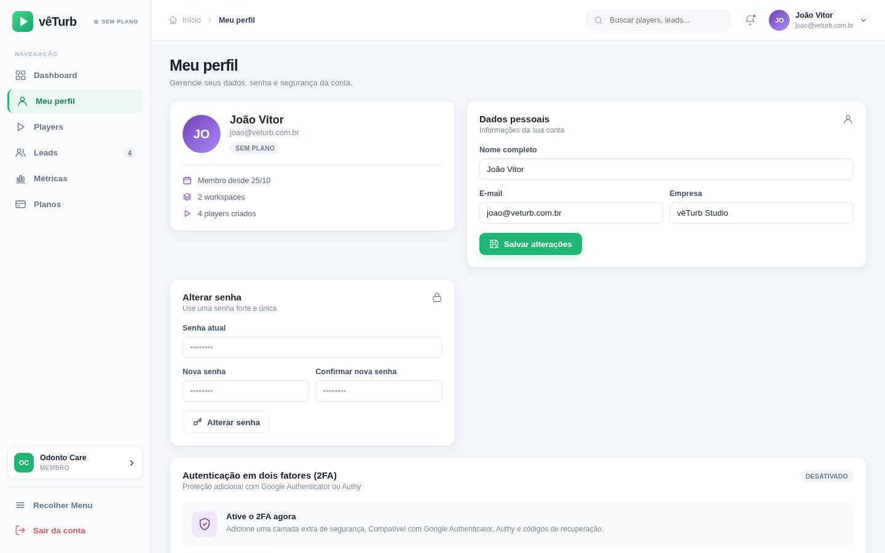

# vêTurb — SaaS de VSLs e Players Inteligentes

Aplicação construída a partir da descrição do produto e da sequência de telas enviadas (painel, builder de player, leads e métricas). O projeto funciona em modo demonstração com `localStorage` e agora inclui integração opcional de autenticação/persistência de estado no Supabase, suporte a vídeos Gumlet via URLs MP4/HLS e miniatura personalizada. Para ativar o Supabase são necessárias as variáveis públicas do seu projeto e a migração SQL; detalhes abaixo.



---

## ▶️ Como executar

```bash
cd /home/user/veturb
npm install
npm run dev          # http://localhost:5173  (bind 0.0.0.0 — compatível com o preview do Arena)
```

Build de produção:

```bash
npm run build        # gera dist/
npm run preview      # serve dist/ em 0.0.0.0:4173
```

Requisitos: Node.js 20.19+ (testado em 20.20.2). Sem configurar variáveis, o app abre em modo demonstração local. Para persistência entre dispositivos, configure o Supabase seguindo a seção abaixo.

**Acesso demo (sem Supabase):** qualquer e-mail + senha com 4+ caracteres, por exemplo `joao@veturb.com.br` / `1234`.
**Com Supabase configurado:** login e criação de conta usam Supabase Auth.
Se o 2FA demo estiver ativado, o código de 6 dígitos é exibido na própria tela de login (no momento, o TOTP/MFA real ainda não está ligado ao Supabase).

---

## 🗄️ Configurar banco Supabase

O projeto tem integração com Supabase Auth e sincronização do estado privado da conta (`veturb_state`). Nesta sessão, a migração foi aplicada ao projeto **Lead turb pro** (região `sa-east-1`) e o preview foi configurado para esse projeto. Para reproduzir em outro ambiente/projeto:

1. No **SQL Editor**, execute `supabase/migrations/001_veturb_state.sql`.
2. Copie `.env.example` para `.env.local` e preencha `VITE_SUPABASE_URL` e `VITE_SUPABASE_ANON_KEY` com **Project URL** e **anon/public key** do painel Supabase.
3. Reinicie o Vite (`npm run dev`). Use **Criar conta** para registrar um usuário; em seguida entre com esse e-mail e senha.

A chave `anon/public` pode ser usada no navegador **somente junto com RLS**, como a política da migração. **Nunca coloque a `service_role key` no front-end**, nem a envie por chat. Sem as variáveis, segue funcionando em modo local. O estado principal do painel é armazenado como JSON por usuário autenticado; o esquema normalizado, MFA, colaboração entre usuários do mesmo workspace, publicação pública de players e ingestão segura de eventos/Leads via Edge Functions precisam de configuração complementar antes de produção.

---

## 🧭 Rotas

| Rota | Tela |
| --- | --- |
| `#/dashboard` | KPIs, gráfico de views/plays, retenção, conversões e atividade recente |
| `#/players` | Lista de players, busca, filtro, duplicar, ativar/desativar, excluir, incorporar |
| `#/players/new` | Builder de criação (13 seções + preview em tempo real) |
| `#/players/:id/edit` | Edição do player + códigos de incorporação |
| `#/leads` | Leads capturados, busca, filtro por player e exportação CSV |
| `#/metrics` | Curva de retenção, funil de conversão, performance por player, log de eventos |
| `#/plans` | Planos, checkout PIX Mercado Pago (simulado) e liberação automática |
| `#/profile` | Dados, senha, 2FA com app autenticador e códigos de recuperação |
| `#/p/:id` | Player público (rota de embed ultra rápida, com console de eventos) |
| `#/embed/:id` | Player minimalista sem chrome, pronto para iframe |

O roteamento é por hash, então funciona em **Vercel, Netlify, Cloudflare Pages, hospedagem compartilhada, VPS e serverless** sem regras de rewrite.

---

## 🎛️ Builder — as 13 seções das capturas

A coluna esquerda replica a estrutura das imagens, em acordeão (uma seção aberta por vez). A seção aberta **liga o recurso correspondente no preview**, exatamente como na sequência de telas enviada.

1. **Configurações** — nome e formato 16:9 ou 9:16; origem YouTube, MP4/arquivo ou Gumlet. Para Gumlet, há campos distintos para link de compartilhamento, MP4, HLS (.m3u8) e miniatura. HLS toca com hls.js; YouTube tenta miniatura automática e aceita URL de miniatura manual como alternativa.
2. **Aparência** — cor da linha de destaque, botões controladores, fundo e texto.
3. **Controles** — menu de qualidade, voltar/avançar 5s, tela cheia, timecode, barra de progresso.
4. **Progresso Simulado** — fake progress com velocidade e grossura da barra.
5. **Play & Pausa** — botão play SVG/imagem, cor, escala, modal de pausa, overlay customizado.
6. **Botão de Ação (CTA)** — botão ou imagem, texto, 13 ícones, cores, URL, tempo de aparição, posição, tamanho, arredondamento e 10 animações.
7. **Cronômetro Regressivo** — duração, aparece após, texto de urgência, 6 posições, presets de tema, cores e ação ao expirar.
8. **Simulação ao Vivo** — selo LIVE, min/max espectadores, visitantes reais, posição, cores e bolinha pulsante.
9. **Anúncios em Vídeo** — múltiplos anúncios com segundo de entrada, "pular após" e duração.
10. **Intenção de Saída** — título, texto, botão, URL, exibir apenas uma vez e cores do popup.
11. **Captura de Leads** — gatilho em segundos, título, subtítulo, cores e texto do botão.
12. **Rastreamento** — Facebook Pixel ID, GTM ID e toggles dos eventos automáticos.
13. **Domínios Permitidos** — whitelist de domínios e bloqueio de Inspect Element/DevTools.




A coluna central traz o preview responsivo com alternância **Vídeo Horizontal / Vídeo Vertical (Shorts)**; a direita mostra o estado bloqueado antes de salvar e, depois, libera o **código iframe responsivo** e o **link direto** com botões de copiar.

**Gumlet:** envie o arquivo na biblioteca do Gumlet; em **Share video → URLs**, copie a URL MP4 (recomendada) ou HLS `.m3u8` e a URL da miniatura para os campos correspondentes no vêTurb. O campo Share URL é guardado como referência; ele não substitui o URL direto de reprodução. O HLS é reproduzido via hls.js em navegadores sem suporte HLS nativo.



---

## 🎥 Player público

- Usa a **YouTube IFrame Player API** quando a URL é do YouTube, `<video>` HTML5 para MP4/upload e um modo de simulação quando não há mídia (ou se o YouTube travar — fallback automático após 2,5s).
- Gate "SEU VÍDEO JÁ COMEÇOU / Clique para ouvir" com desbloqueio de áudio.
- Controles customizados, quality menu, seek ±5s, fullscreen, timecode e fake progress.
- **CTA cronometrado**, selos de escassez/LIVE com contador de espectadores, anúncios overlay, modal de retomada inteligente (salva progresso), modal de pausa, exit intent e formulário de captura de leads.
- Whitelist de domínios e bloqueio de DevTools funcionam de verdade na rota pública.
- Console de eventos em tempo real em `#/p/:id`.



Para testar o fluxo completo: abra `#/p/ply_odonto?preview=1`, clique em "Clique para ouvir" e aguarde o formulário de lead (12s). O lead aparece imediatamente em **Leads** e incrementa as métricas.

---

## 📊 Rastreamento e métricas

Ao interagir com o player público, os eventos são gravados e também enviados para as integrações nativas quando os IDs estão configurados:

| Evento interno | Facebook Pixel | GTM / dataLayer |
| --- | --- | --- |
| `view` | `PageView` | `page_view` |
| `play` | `PlayerPlay` | `player_play` |
| `progress` (25/50/75/95%) | `PlayerProgress` | `player_progress` |
| `cta` | `PlayerCtaClick` | `player_cta_click` |
| `conversion` (lead) | `PlayerLead` | `player_lead` |

`window.fbq` e `window.dataLayer` são chamados quando presentes; independentemente disso, tudo é registrado localmente para o dashboard, a curva de retenção, o funil de conversão e o log de eventos.




---

## 🔐 Segurança, pagamentos e multi-tenant

- **2FA**: ativação com chave secreta + QR, código de 6 dígitos (compatível com Google Authenticator/Authy) e 6 códigos de recuperação. O login passa a exigir o código.
- **Mercado Pago**: checkout PIX com QR Code, "copia e cola" e botão de simulação de pagamento que libera o plano na hora (badge do sidebar muda).
- **Workspaces**: alternância entre `Odonto Care` e `Demo VSL`, com players, leads e eventos isolados por tenant.




---

## ⚠️ O que é real e o que é simulado

| Item | Status |
| --- | --- |
| Interface completa, builder, preview, embeds, player, gráficos, leads, 2FA, workspaces | ✅ Funcional |
| Persistência em modo demonstração | ✅ `localStorage` (neste navegador) |
| Supabase Auth + estado JSON privado por usuário | ✅ Integração opcional preparada; requer URL/chave pública e migração SQL |
| YouTube IFrame API / MP4 HTML5 / Gumlet MP4 e HLS | ✅ Compatibilidade implementada (Gumlet via URLs copiadas do painel) |
| Eventos `fbq` / `dataLayer` | ✅ Disparados quando os scripts/IDs existem |
| Whitelist de domínios e bloqueio DevTools | ✅ Real na rota pública |
| Checkout Mercado Pago PIX | 🔶 Simulado (sem chamada à API, sem cobrança) |
| Código TOTP do 2FA | 🔶 Demo (código exibido na tela, não é TOTP criptográfico) |
| Upload de vídeo/imagem | 🔶 URL local temporária da sessão (`URL.createObjectURL`) |
| Upload do vídeo para Gumlet a partir do vêTurb | ⛔ Não é upload direto: envie no Gumlet e cole os URLs MP4/HLS/miniatura no builder |
| Players públicos e ingestão de eventos/leads por Edge Function no Supabase | 🔶 Ainda exigem endpoints/funções de servidor antes de produção |
| Cobrança Mercado Pago e armazenamento permanente de arquivos | 🔶 Simulados/não configurados |

A descrição original cita **React 19, Vite 7, Tailwind v4, shadcn/ui, TanStack Query, React Router e Supabase**. Esta implementação usa **React 19 + Vite 6 + CSS puro**, hash routing, camada local de demonstração e integração Supabase opcional (`src/lib/supabase.js`).

### Variáveis de ambiente

```bash
VITE_SUPABASE_URL=https://seu-projeto.supabase.co
VITE_SUPABASE_ANON_KEY=sua_chave_anon_publica
VITE_EMBED_BASE_URL=https://seu-dominio.com.br
```

As duas primeiras conectam autenticação e sincronização privada do painel. A última define a base dos links de iframe/player; se omitida, usa a origem atual. No Vercel, configure essas variáveis nas opções do projeto e substitua `VITE_EMBED_BASE_URL` pelo domínio publicado. A chave `service_role` não deve ser usada no front-end.

---

## 📁 Estrutura

```
veturb/
├── index.html
├── package.json
├── vite.config.js          # host 0.0.0.0, allowedHosts para preview
├── README.md
├── docs/screenshots/        # capturas das telas geradas
└── src/
    ├── main.jsx
    ├── App.jsx              # shell, sidebar, roteamento hash, auth, notificações
    ├── styles.css           # design system completo
    ├── lib/
    │   ├── db.js            # estado, seed multi-tenant, eventos, agregações
    │   ├── ctx.jsx          # context da aplicação
    │   └── icons.jsx        # ícones SVG inline
    ├── components/
    │   ├── ui.jsx           # botões, campos, toggles, modais, gráficos
    │   └── PlayerEngine.jsx # motor do player (builder + público)
    └── pages/
        ├── Auth.jsx  Dashboard.jsx  Players.jsx  Builder.jsx
        ├── Leads.jsx  Metrics.jsx  Plans.jsx  Profile.jsx
        └── PublicPlayer.jsx
```

---

## ✅ Validação

- `npm run build` — passa sem erros.
- Smoke tests com Playwright/Chromium em todas as rotas: **zero erros de console**.
- Fluxos testados ponta a ponta: login → 2FA, criação/edição/salvamento de player, geração de embed, player público → captura de lead → tabela de leads → métricas, checkout PIX → ativação de plano, troca de workspace.
